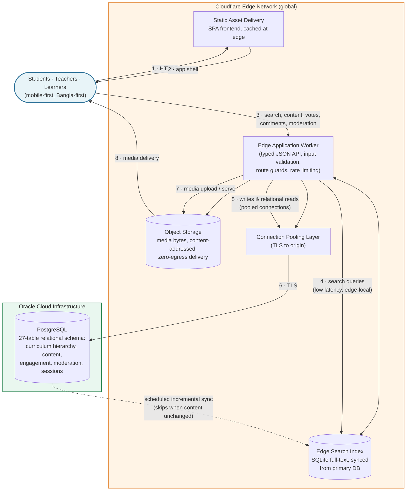

# Muktibeg Community — A Scalable, Edge-Accelerated Learning Community Platform

**A bilingual (Bangla-first) community platform where students, teachers, and learners collaboratively build, discuss, and moderate curriculum-aligned educational content — backed by a highly optimized PostgreSQL database on cloud infrastructure and an edge-network search layer that keeps every query fast, even at national scale.**

Muktibeg Community organizes all content around the national curriculum hierarchy — Education Level → Class → Group/Stream → Subject → Paper → Chapter → Topic — and lets the community contribute notes, questions, solutions, and curated learning resources under each topic. Every contribution flows through a structured moderation pipeline, and every search is answered by a globally distributed edge index rather than a distant database.

---

## Target Audience & Business Value

| Audience | What they get |
| --- | --- |
| **Students** | A single, curriculum-organized home for notes, worked solutions, and practice questions — searchable in seconds, in their own language, on low-end mobile devices. |
| **Teachers & educators** | Structured authoring workflows, bulk content publishing, edit suggestions, and a volunteer program that formalizes community contribution. |
| **Learners & self-studiers** | Community-driven quality signals — voting, reputation, bookmarks, and discussion threads — that surface the best material naturally. |
| **Platform operators** | A moderation and governance suite (content review queues, user strikes, copyright takedown handling, audit surfaces) that keeps a large community healthy without a large moderation team. |

**Business value:**

- **Built for scale from day one.** A stateless edge application tier, pooled database connectivity, and a derived search index mean the platform grows from a single subject track to multiple education levels without re-architecture.
- **Performance as a product feature.** Search is served from the edge network close to the user, not from a central database — keeping latency low for a mobile-first audience.
- **Trust by design.** Transparent moderation states, community reporting, copyright compliance tooling, and privacy-conscious session handling make the platform defensible for institutional partnerships.
- **Bilingual by default.** Bangla-first interfaces and content naming (with English alongside) remove the language barrier that keeps most global platforms from serving Bangladeshi learners well.

---

## Key Features

### Community engagement

- **Collaborative content model** — notes, questions, solutions, and curated learning resources attached to every curriculum topic, with a wiki-style edit-suggestion workflow: anyone can propose an improvement, reviewers approve or reject it.
- **Quality signals** — StackOverflow-style up/down voting with instant toggle and flip semantics, denormalized vote scores for fast ranking, one-report-per-user flagging, and threaded comments.
- **Reputation & gamification** — contribution events accrue reputation, and a volunteer program (content creation or moderation tracks) with application review and role promotion formalizes the path from user to contributor.
- **Personal spaces** — bookmarks with list merging, learner profiles, and similar-question discovery for targeted practice.
- **Creator onboarding** — federated sign-in, plus a dedicated creator-verification flow that lets educators prove ownership of their YouTube channel before publishing takedown-protected resources.

### Fast edge search

- **Edge-network search index.** A SQLite-based full-text index runs on the edge network, synced from the primary PostgreSQL database — search queries never wait on a cross-region database round trip.
- **Bangla-aware text handling.** The indexing pipeline was validated for Bengali grapheme clusters, so Bangla queries match as reliably as English ones, with relevance-ranked results and snippet highlighting.
- **Incremental, budget-aware sync.** A content-manifest check (row counts plus last-modified watermarks) skips reindexing entirely when nothing changed; a scheduled self-heal rebuild bounds drift, and per-client rate limiting protects the shared index from abuse.
- **Graceful degradation.** A secondary substring-matching path covers tokenizer gaps, automatically falling back when primary ranking finds nothing.

### Scalable data handling

- **A highly optimized PostgreSQL database on Oracle Cloud infrastructure**, modeled with 27 relational tables: a six-level curriculum hierarchy with bilingual naming, transactional moderation state machines (draft → pending → approved/rejected → archived), vote and report aggregation, sessions, media metadata, and governance records.
- **Pooled, accelerated database connectivity.** All database traffic flows through a connection-pooling layer with TLS to origin, so thousands of concurrent edge requests multiplex over a managed pool instead of exhausting direct connections.
- **Object storage for media at the edge.** Binary content (images, PDFs) lives in S3-compatible object storage with content-addressed keys, MIME allowlists, size caps, and atomic upload-or-rollback semantics — the database keeps only queryable metadata.
- **Type-safe data access end to end.** A schema-first ORM with generated, reviewable SQL migrations; every API input validated by contract schemas before it touches the service layer.
- **Hardened session handling.** Opaque 256-bit session tokens are stored server-side only as SHA-256 digests — logout is instant revocation, and even a leaked database dump cannot be replayed into a login.

---

## High-Level Architecture

**Reading the diagram:** users interact only with the edge network. The edge worker answers search from an edge-local index and multiplexes all relational traffic over a pooled, TLS-encrypted connection to the primary PostgreSQL database on Oracle Cloud. Binary media never passes through the database at all — it flows from object storage straight to the browser. The primary database remains the single source of truth; the search index is derived and fully rebuildable at any time.

---

## Tech Stack

| Layer | Technology |
| --- | --- |
| **Frontend** | React 19 + Vite, TypeScript strict mode; rich-text editor with mathematics notation (TipTap + KaTeX); Bangla-first, mobile-first, accessible UI with Noto Sans/Serif Bengali typography |
| **Backend** | Cloudflare Workers (TypeScript) — single deployable unit serving both the typed JSON API and the static frontend; zero-dependency router; schema-validated inputs |
| **Database** | PostgreSQL on Oracle Cloud Infrastructure, accessed through a type-safe ORM with generated, reviewable migrations; connection pooling over TLS for production traffic |
| **Search & edge data** | SQLite-based full-text index on the edge network, incrementally synced from PostgreSQL on a schedule with drift self-healing |
| **Media storage** | S3-compatible object storage on the edge network (content-addressed keys, atomic upload semantics, edge-cached delivery) |
| **Cloud providers** | Cloudflare (application delivery, search, storage) + Oracle Cloud (self-managed PostgreSQL with hardened networking, encrypted block storage, and a documented backup/recovery plan) |
| **Quality & delivery** | Automated CI/CD pipeline: typecheck → lint → unit/integration tests → build → database migration → deploy; scheduled reindex and media-integrity workflows |

---

## Links

- **Live Website:** [community.muktibeg.com](https://community.muktibeg.com)
- **Demo Video:** [Demo Video Link]
- **Screenshots:** [Screenshots]

---

## Related Portfolio Projects

- [Muktibeg Flashcard Ecosystem](https://github.com/AliRezaBmeDu/flashcard-ecosystem-architecture) — cross-platform flashcard learning products for Bangladeshi students
- [Muktibeg Campus — EdTech SaaS](https://github.com/AliRezaBmeDu/showcase-muktibeg-campus-saas) — multi-tenant institution management platform
- [TunaTools — Privacy-First Web Tools](https://github.com/AliRezaBmeDu/tunatools-privacy-first-web-tools) — 119 browser-based utilities with 100% client-side processing

---

> This repository is a client-facing showcase of the Muktibeg Community architecture. It documents the platform's design, engineering decisions, and capabilities; the source code remains private.
